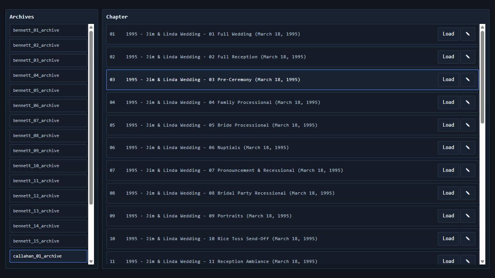
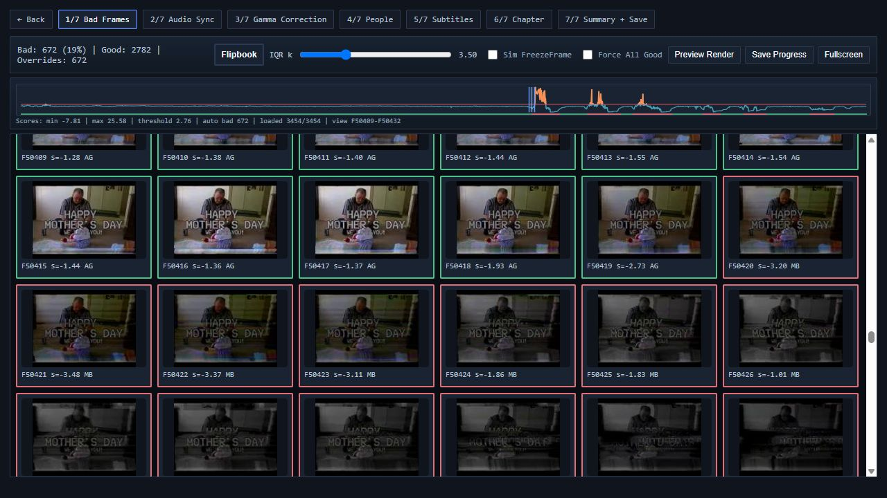
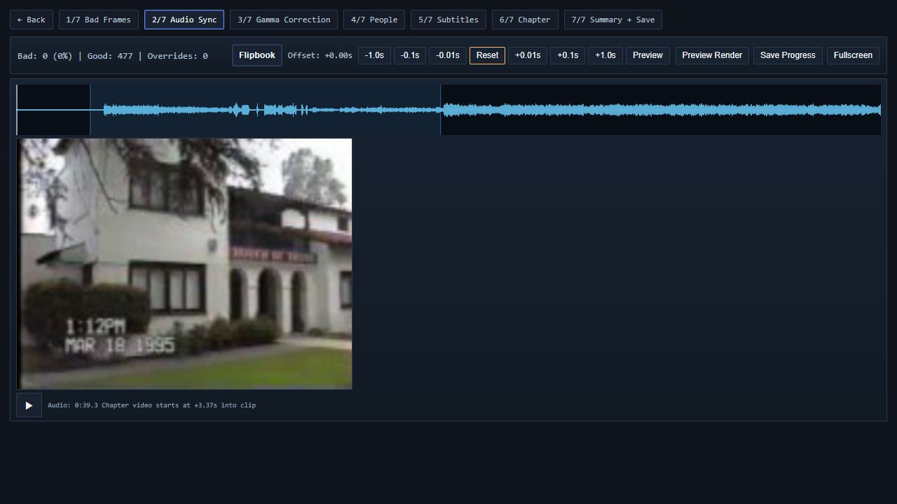
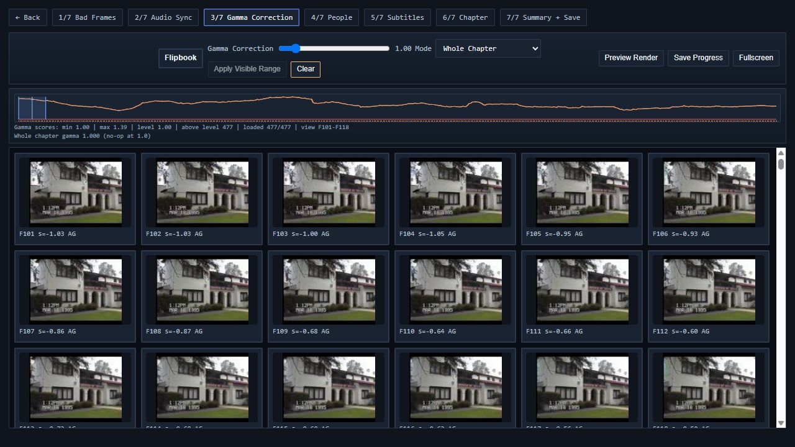
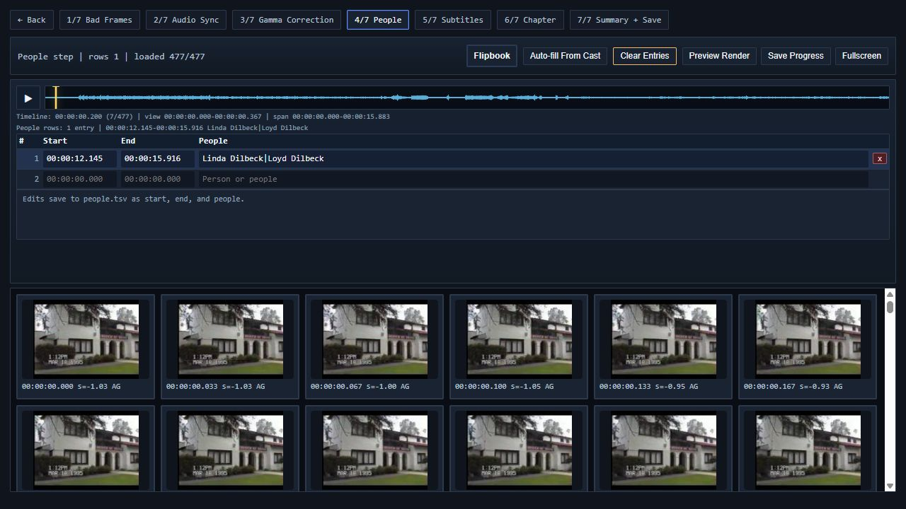
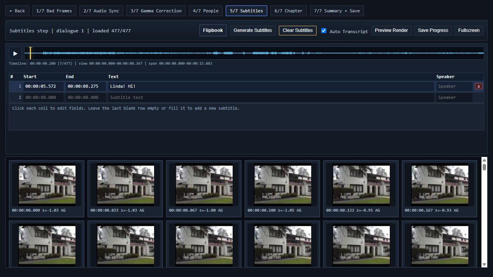
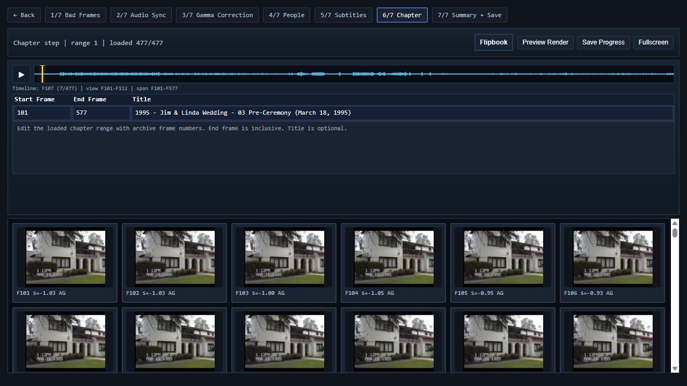
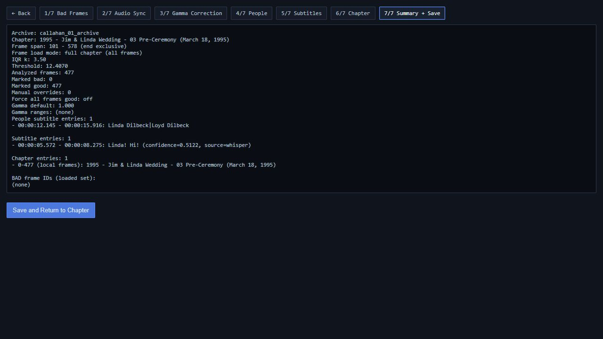

# imago

Family media archive for VHS digitization, photo album preservation, and shared face IDs.

## Components

### Photo albums — scan preservation and photo extraction

[`photoalbums/`](photoalbums/) turns physical album scans into browsable pages, individual photos, and searchable metadata.

- Watches incoming scans and supports scan registration and rescan review.
- Compresses TIFF scans, validates stitchability, and stitches oversized pages into JPEG page views.
- Detects photo regions on pages, extracts individual photos, and supports AI photo restoration and optional crop verification.
- Uses OCR and AI indexing to extract text, generate captions, and infer dates and locations; a map UI supports manual GPS correction.
- Propagates page context to crops, refreshes and reconciles face regions, and sequences page dates across album date anchors.
- Stores metadata and processing state in XMP sidecars, with checksum manifests for integrity checks and repair/migration commands for existing archives.

Use it to preserve the original scans while producing useful viewing copies. Each album has sibling `_Archive` (source scans), `_Pages` (page JPEGs), and `_Photos` (individual crops) folders.

Start with `just photoalbums-scan-pipeline` for incoming scans or `just photoalbums-render-pipeline` for processing an existing collection. Use `just photoalbums-list-render-pipeline-steps` to inspect the current pipeline and `just photoalbums-map` to review locations. See the [pipeline specification](photoalbums/SPEC.md) and [CLI](photoalbums/cli.py) for details.

#### Setup and run

1. Complete the shared setup below. Install ImageMagick (including its shared library for Wand) and ExifTool; ensure `magick` and `exiftool` are on PATH. On Windows, `PHOTOALBUMS_IMAGEMAGICK_DIR` can point to the ImageMagick installation.
2. Set `PHOTOALBUMS_DIR` to your Photo Albums root for the `just` recipes. Set `PHOTO_SCANNING_DIR` if the scan watcher should use a different root. For MCP, also update the archive and scanwatch `photos_root` entries in `photoalbums/album_sets.toml`; these currently contain machine-specific paths.
3. Start the local AI server described below (or your configured LM Studio server). Set the endpoint and model aliases in `photoalbums/ai_models.toml`; `LMSTUDIO_BASE_URL` overrides the endpoint. The CLI reads these settings rather than the similarly named entries in `imago.toml`.
4. Arrange scans using the naming and folder layout in the [specification](photoalbums/SPEC.md), then run the relevant workflow:

```sh
uv run python -m photoalbums watch --list-steps
uv run python -m photoalbums watch --album "Egypt_1975_B00"
uv run python -m photoalbums process --photos-root "/path/to/Photo Albums" --album "Egypt_1975_B00"
uv run python -m photoalbums metadata map "/path/to/Photo Albums" --port 8095
```

The watcher and map are long-running processes; run processing commands in a separate terminal. Open the map at `http://127.0.0.1:8095`. Inspect generated JPEG/XMP pairs in `_Pages` and `_Photos`; use `just photoalbums-checksums` to generate manifests and `just photoalbums-verify-checksums` to verify them.

### VHS — tape conversion, review, and delivery

[`vhs/`](vhs/README.md) processes digitized VHS and U-matic footage into archival files and watchable clips.

- Converts source AVI/MOV captures into archive MKVs and generates preview proxies.
- Builds and embeds chapter metadata, generates checksum manifests, and verifies archives and drives.
- Provides a browser tuner for reviewing bad frames, adjusting gamma, and editing people and dialogue subtitles.
- Generates dialogue transcription and can prefill people subtitle ranges from Cast face matches.
- Renders delivery clips and original-versus-processed comparison videos.

Automatic bad-frame detection looks for four signs of tracking trouble: loss of color, uneven horizontal noise, torn rows, and horizontal waviness. It combines these measurements into a score and flags unusually high-scoring frames relative to the footage being reviewed. The tuner's `IQR k` control adjusts sensitivity: lower values flag more frames, higher values flag fewer. Review the suggestions and override individual frames before saving; detection records repair metadata without changing the archive video. See the [full bad-frame detection breakdown](vhs/README.md#tracking-loss-classifier) for the scoring, threshold calculation, and rendering behavior.

Use it after tape capture to organize recordings, review restoration settings, and export family videos. Start with `uv run python vhs/vhs.py -h` or open the tuner with `just vhs-tuner`. The [capture guide](vhs/CAPTURE_GUIDE.md) covers capture preparation.

#### Setup and run

1. Complete shared setup and bootstrap the bundled media binaries. The platform-specific FFmpeg/FFprobe paths are defined in [`vhs/common.py`](vhs/common.py); macOS uses the bundled ARM64 binaries, Windows uses the bundled QTGMC toolchain, and Linux supports `FFMPEG_BIN`/`FFPROBE_BIN` overrides.
2. Convert a capture using one of the commands below. Conversion writes `<input_stem>_archive.mkv` beside the input file.
3. For archive discovery, place MKVs under `../video_data/<store>/Archive/` relative to the repository root. The store is the first underscore-separated part of the archive name (for example, `bennett_01_archive` belongs to `bennett`). Chapter and review metadata live under `vhs/metadata/<archive>/`; use the existing files there as format examples.

```sh
uv run python vhs/vhs.py convert avi "/path/to/bennett_01.avi"
# For U-matic captures instead:
uv run python vhs/vhs.py convert umatic "/path/to/capture.mov"
uv run python vhs/vhs.py metadata build
uv run python vhs/vhs.py proxy
uv run python vhs/vhs.py tuner --host 127.0.0.1 --port 8092
```

Open `http://127.0.0.1:8092`, select a chapter, review frames/gamma/subtitles, and save. In another terminal, run `just vhs-render` to render using saved settings and `just vhs-verify-archive` to check archive manifests. See the component README for chapter metadata and rendering options.

#### Tuner screenshots

The tuner walks through seven review steps after loading a chapter. Most screenshots use the Pre-Ceremony chapter from a digitized Callahan wedding tape; the bad-frame example shows tracking damage in the Callahan Mother's Day footage.

**Archives and chapters** — Select a tape and load a chapter.



**Bad frames** — Score spikes highlight suspect footage. Red borders mark bad frames; green borders mark good frames. Inspect the tracking damage and override classifications as needed.



**Audio sync** — Align audio with the picture using fine timing offsets.



**Gamma correction** — Adjust gamma for the whole chapter or visible-range regions.



**People** — Review who appears and edit their time ranges.



**Subtitles** — Review dialogue and edit subtitle timing, text, and speakers.



**Chapter** — Set chapter boundaries and title.



**Summary and save** — Check the collected settings before saving.



### Cast — shared people and face identities

[`cast/`](cast/README.md) maintains a shared identity collection for photo albums and video footage.

- Detects faces in photos and sampled video frames using InsightFace, saving face crops and embeddings.
- Suggests identity matches with confidence gates and queues faces for human review.
- Supports bulk assignment, creation of people, aliases and notes, and inspection of the source image behind a face crop.
- Labels photos through XMP sidecars and imports named face boxes from Immich into local sidecars.
- Stores identities, face observations, and review decisions in JSON/JSONL files under `cast/data/`.

Use it to identify the same person across albums and tapes and to supply people metadata to the photo and VHS workflows. Run `just cast-init`, then `just cast-web`; use `just cast-immich-sync --dry-run` to preview an Immich import.

#### Setup and run

Complete shared setup. The first face-ingest operation downloads InsightFace `buffalo_l` model assets, so allow network access for that first run. Photo sidecar operations also require ExifTool on PATH.

```sh
uv run python -m cast init
uv run python -m cast web --host 127.0.0.1 --port 8093
```

Open `http://127.0.0.1:8093`, ingest a photo/video or an album folder, and assign the detected faces to people. Confirm the UI reports the active `buffalo_l` stack before ingesting. The default store is `cast/data/`.

For Immich imports, set `IMMICH_URL` to your server URL and `IMMICH_API_KEY` to an API key created in Immich, then preview and apply:

```sh
uv run python -m cast immich-sync --photos-root "/path/to/Photo Albums" --dry-run
uv run python -m cast immich-sync --photos-root "/path/to/Photo Albums"
```

### Viewer — browse the finished archive

[`viewer/`](viewer/README.md) is a lightweight gallery for photos and videos.

- Scans media folders into a `gallery.json` catalog, including discovery using Imago folder conventions.
- Offers a mixed-media grid and an image-only photobook with two-page spreads.
- Streams local filesystem media through a local web server, with optional allowed-root restrictions.
- Supports remote media URLs and static hosting, with configurable branding.

Use it to browse or present processed media. Start by generating the catalog with `uv run python viewer/scan_media.py --imago-layout`, then run `uv run python viewer/server.py`.

#### Setup and run

Complete shared setup, then generate a catalog from explicit media roots (repeat `--root` as needed). Edit `viewer/config.json` to set the gallery branding.

```sh
uv run python viewer/scan_media.py --root "/path/to/Photo Albums" --root "/path/to/Videos" --output viewer/gallery.json
uv run python viewer/server.py --host 127.0.0.1 --port 8096 --allow-root "/path/to/Photo Albums" --allow-root "/path/to/Videos"
```

Open `http://127.0.0.1:8096` and check an image and a video. This example uses 8096 so the photo map can keep 8095. Regenerate the catalog after adding media. For static hosting, use remote URLs in the catalog; local filesystem paths require the Python server.

### Immich — hosted photo library and maintenance

[`immich/`](immich/README.md) contains the local Immich deployment and archive integration tools.

- Runs Immich, its database, cache, machine-learning service, and Immich Power Tools through Docker Compose.
- Mounts the Photo Albums tree read-only as an external library for indexing.
- Creates Immich photo albums from the local collection.
- Provides database backup tooling and a PowerShell restore workflow for cluster dumps.

Use it to make the collection available through Immich and maintain that deployment. Follow the component README for setup; `just immich-photoalbums` manages albums and `just immich-backup` runs the backup workflow.

#### Setup and run

1. Install Docker with Compose and start its engine.
2. Copy `immich/.env.example` to `immich/.env`. Set the upload location, photo-library location, database credentials, external URL, and JWT secret. Add `BENNETT_PHOTOS_LOCATION`, which the Compose file requires but the example environment file does not yet include.
3. Review `immich/docker-compose.yml`: replace the hard-coded Windows Callahan video mounts with your own folders, or remove mounts you do not use. Check that all host paths exist.
4. For a new installation, validate the configuration and start the core services:

```sh
docker compose --project-directory immich config --quiet
docker compose --project-directory immich up -d database redis immich-machine-learning immich-server
```

Open `http://localhost:2283`, create the initial account, and create an API key. Put that key in `immich/.env` as `IMMICH_API_KEY`, then run `docker compose --project-directory immich up -d` to start Power Tools as well. Open Power Tools at `http://localhost:3000`. Add `/cordell_photos` as an Immich external library and scan it; add the other mounted paths if needed. Check service status with `docker compose --project-directory immich ps`.

For an existing database dump, follow the separate [restore procedure](immich/README.md) instead of initializing a new library. Set `IMMICH_URL` and `IMMICH_API_KEY` in your shell for Cast imports. See `uv run python immich/create_photo_albums.py --help` and `uv run python immich/backup.py --help` before running album or backup operations.

### FamilySearch — genealogy export and visualization

[`familysearch/`](familysearch/README.md) brings family-tree context into the archive.

- Downloads an ancestor tree from FamilySearch as GEDCOM, with configurable starting person and generation limit.
- Renders ancestor trees and relationship graphs from GEDCOM; tree rendering can include Cast face crops.
- Includes an experimental yEd GraphML exporter for exploring the tree in a graph editor.

Use it to preserve and visualize family relationships alongside the media collection. Run `just familysearch-download` after configuring FamilySearch credentials; the rendering scripts expose their options through `--help`.

#### Setup and run

Complete shared setup and set `FAMILYSEARCH_PASSWORD` in your shell environment. Supply your own username and starting person ID rather than relying on the repository's personal defaults:

```sh
just familysearch-download --username YOUR_USERNAME --person-id YOUR_PERSON_ID --generations 6 --output familysearch/data/ancestors.ged
```

The recipe installs the pinned `getmyancestors` dependency through `uv run --with`. Confirm that the GEDCOM output was created. To render it, install Graphviz and provide the path to its `dot` executable (the script default is a machine-specific Homebrew path):

```sh
uv run python familysearch/render_tree_svg.py --gedcom familysearch/data/ancestors.ged --dot-bin /absolute/path/to/dot --output familysearch/data/ancestors.svg
```

Set `--root-id` if the desired GEDCOM root is not `@I1@`. Open the resulting SVG in a browser. The relationship-graph and yEd export scripts in `familysearch/` also provide `--help`.

### Local AI server — model inference

[`llama/`](llama/README.md) contains startup configuration for serving a local Gemma GGUF model through llama.cpp.

- Provides a local OpenAI-compatible inference endpoint for the photo pipeline.
- Configures the language model and multimodal projector used for image-aware requests.
- Includes platform startup support and a root `just llama-gemma4` entry point.

Use it when running photo analysis against a locally hosted model. Configure the model files before starting it, and keep the endpoint and model selections in [`photoalbums/ai_models.toml`](photoalbums/ai_models.toml) aligned with the deployment.

#### Setup and run

1. Install llama.cpp using `just llama-install` (Homebrew on macOS or WinGet on Windows). The root launcher also requires Nushell (`nu`) and a `python3` executable for its log filter.
2. Copy `llama/.env.example` to `llama/.env`. Obtain the GGUF model and matching multimodal projector, then set `MODEL_DIR`, `MODEL_FILE`, `MMPROJ_FILE`, and `MODEL_ALIAS`. The current example targets Gemma 4 31B; choose files that fit your hardware and keep the alias aligned with `photoalbums/ai_models.toml`.
3. Set `HOST=127.0.0.1` for local use and start the server:

```sh
nu llama/start.nu
```

Alternatively, `just llama-gemma4` runs the install recipe and launcher together. Check `http://127.0.0.1:8080/v1/models` for the configured alias. The photo pipeline endpoint is `http://127.0.0.1:8080/v1`; logs are written to `logs/llama.log`. The current `.env.example` and Nushell launcher take precedence over the older 12B examples in `llama/README.md`.

### MCP — automation and job monitoring

[`imago_mcp/`](imago_mcp/server.py) exposes archive operations to Model Context Protocol clients.

- Queries Cast people/reviews, photo album sets and processing status, XMP metadata, and VHS chapters/settings.
- Launches photo-processing and VHS jobs and manages scan-watcher events and decisions.
- Supports photo-region review and editing through tools.
- Tracks background jobs with status, logs, artifacts, and cancellation, plus a browser console.

Use it to operate the archive through an MCP client and inspect long-running work. See `uv run python -m imago_mcp.server --help` for transport and bind options. The `just mcp-http` recipe advertises a machine-specific console hostname; adjust it for your host before use.

#### Setup and run

Complete shared setup and configure the components whose tools you intend to call, including `photoalbums/album_sets.toml`. **Job launching currently assumes Windows:** `imago_mcp/server.py` hard-codes `.venv/Scripts/python.exe`. Use a Windows checkout for jobs; starting the server on macOS/Linux does not make job execution portable.

```sh
uv run python -m imago_mcp.server --transport http --host 127.0.0.1 --port 8090 --console-host 127.0.0.1
```

Configure your MCP client to use `http://127.0.0.1:8090/mcp`. Open `http://127.0.0.1:8091` for the job console, and verify connectivity with a read-only tool such as `job_list` or `photoalbums_list_sets` before launching work. For another device, bind to a reachable interface and advertise the server's LAN hostname with `--console-host`. That option controls returned console URLs, not the bind address.

For stdio clients, use command `uv` with arguments `run python -m imago_mcp.server --transport stdio` and the repository root as the working directory. The browser console starts only with HTTP/SSE transports.

## Shared setup and development

Install Git, uv, and just, and use Python 3.12 (the project requires >=3.12,<3.13). Run commands from the repository root. Replace example paths and IDs with your own values. Set environment variables in your shell before launching a component: `export NAME="value"` in bash/zsh or `$env:NAME = "value"` in PowerShell.

Use `uv sync` to create/update the Python environment and `just bootstrap` to prepare bundled runtime binaries. [`scripts/`](scripts/) contains bootstrap and quality-check tooling; [`software/`](software/) holds bundled runtime assets.

Configure CLI photo paths through `PHOTOALBUMS_DIR`/`PHOTO_SCANNING_DIR`, AI settings in [`photoalbums/ai_models.toml`](photoalbums/ai_models.toml), and MCP collection settings in [`photoalbums/album_sets.toml`](photoalbums/album_sets.toml). Component READMEs describe additional services and credentials.

Run `just --list` to see the root task shortcuts. For Python changes, validate with `just quality` and `just test`; filesystem, metadata, and external-service changes also need checks against the affected data.
